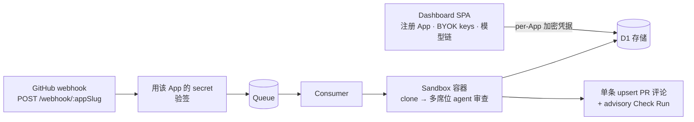

<div align="center">


# [Morning Star Inspector](https://github.com/btspoony/mstar-inspector)

用于自动化 PR 审查的自托管 GitHub App

[English](README.md) / 中文

[](https://github.com/btspoony/mstar-inspector/actions/workflows/ci.yml)
[](LICENSE)
[](https://github.com/btspoony/mstar-inspector/commits/main)

</div>

**mstar-inspector** 是一个自托管的 GitHub App：PR 一旦打开或更新，即刻触发云端自动审查。每次审查作为真实的
多席位 coding-agent 会话运行在隔离的 Cloudflare Sandbox 容器中，结果以单条 upsert 评论回到 PR，结构化
findings 落入 D1 供后续分析。

- **一份部署，多 App 共用** —— 通过 dashboard 注册任意数量的 GitHub App；每个 App 拥有独立的 slug、加密凭据、BYOK provider keys 和模型链
- **隔离执行** —— 每次审查运行在一次性 Cloudflare Sandbox 容器中（clone → review → 销毁），镜像内零密钥
- **结构化结果** —— 审查产出 `mstar.review/v1` envelope（verdict + 分级 findings）持久化到 D1，为后续去重、复现统计和健康分析提供数据层
- **findings 生命周期跨轮保留** —— 未解决的 findings 跨轮存续：每轮将它们对照当前代码与讨论重新验证，结果呈现在同一条总体评论中，且只自动 resolve 那些 Inspector 能证明属于自己、且被积极修复的 review thread（finding 的 *addressed* 处置从不等同于 *resolved* 的 GitHub thread）
- **按 App 的触发模式** —— 每个 App 在 settings 页选择审查何时自动启动：`open`（仅首次打开）、`every_push`（默认——打开、push、重新打开）或 `manual`（从不自动审查）；任何模式下，PR 作者或仓库所有者在 PR 评论中 @提及 App 的 bot（`@your-app-slug[bot]`）即可（重新）启动一次审查
- **设计上 fail-closed** —— 暂停的 App 不再启动新的审查（包括其模型运行）、发布与行内评论创建；只有有界的[恢复例外](docs/deploy.md#lifecycle-recovery-7111)可以完成已授权的工作，且仅限仍处于活跃状态的 App。每个 App 必须自带 provider key 与模型链：配置缺失的 App 审查会大声失败，绝不动用别人的凭据

## 架构



一份部署服务任意数量的 GitHub App。每个 App 通过 dashboard 注册，自带加密凭据、provider key（BYOK）
与模型链，存放在 D1——部署层不存在共享的审查凭据。入站 webhook 按 App slug 路由，审查在一次性
Sandbox 容器中逐个运行，每个结果都以结构化形式（`mstar.review/v1`）落入 D1，供去重、复现统计与健康
分析使用。

部署形态只有一个开关：`DEPLOYMENT_MODE`——`self-hosted`（`wrangler.jsonc` 顶层默认值，用于你自己的
副本）或 `saas`（本仓库自己的多租户服务）。代码层没有默认值：未设置或拼错会在启动时明确失败。你几乎
一定需要 `self-hosted`；另一种形态的说明面向运营方，见
[`docs/deploy.md` § Deployment mode](docs/deploy.md#deployment-mode-deployment_mode)。

## 快速开始

把某个定版 release 部署到你自己的 Cloudflare 账号：

> 前置：[Cloudflare](https://developers.cloudflare.com/workers/) 账号（Workers + D1 + Queues + Containers）、GitHub 账号、本地
> [Bun](https://bun.sh) ≥ 1.4.0。完整 runbook——Cloudflare 资源初始化、D1 迁移、secrets 清单、go-live
> checklist——见 [`docs/deploy.md`](docs/deploy.md)。

1. **锁定定版**——发布的版本以 tag 形式提供（见 [Releases 页面](https://github.com/btspoony/mstar-inspector/releases)）；部署某个 tag 即部署该份源码，sandbox 容器镜像也会在该 checkout 上于部署时重新构建：

   ```bash
   git clone https://github.com/btspoony/mstar-inspector && cd mstar-inspector
   git checkout <tag>          # 例如 v1.0.0
   bun install
   ```

2. **创建你自己的 Cloudflare 资源**并让配置指向它们——`wrangler.jsonc` 里提交的两个 id 是本仓库的，换成你自己的：

   ```bash
   wrangler queues create review-queue
   wrangler queues create review-dlq
   wrangler kv namespace create IDEMPOTENCY_KV   # 新 id → wrangler.jsonc kv_namespaces
   wrangler d1 create mstar-inspector-db         # 新 id → wrangler.jsonc d1_databases
   ```

3. **应用 D1 迁移**：

   ```bash
   wrangler d1 migrations apply mstar-inspector-db --remote
   ```

4. **设置四个 Worker secret**（Worker 层命名，直接设置——不经过 GitHub Secrets；两个随机值用 `openssl rand -base64 32` 生成；OAuth App 为 GitHub **OAuth App**，回调地址 `{origin}/dashboard/oauth/callback`）。审查用的 GitHub App 不是 Worker secret——后面通过 dashboard 按 App 注册：

   ```bash
   wrangler secret put GITHUB_OAUTH_CLIENT_ID
   wrangler secret put GITHUB_OAUTH_CLIENT_SECRET
   wrangler secret put DASHBOARD_SESSION_SECRET
   wrangler secret put DASHBOARD_ENCRYPTION_KEY
   ```

5. **构建、部署、验证**——`/healthz` 会回报部署的版本，可直接确认线上跑的就是你 pin 的 tag：

   ```bash
   bun run build:spa        # 必需——SPA 产物不进 git
   wrangler deploy          # 同时构建/推送 sandbox 容器镜像
   curl https://<your-worker>/healthz   # {"ok":true,"version":"vX.Y.Z"}
   ```

   `wrangler deploy` 从 `wrangler.jsonc` 顶层 `vars` 取 `DEPLOYMENT_MODE`（`self-hosted`）——对自托管副本
   是正确取值。部署形态开关见[架构](#架构)一节。

   无需任何登录名单：登录对任意 GitHub 账号开放，第一个进来的人创建工作区并成为其所有者——见
   [`docs/deploy.md`](docs/deploy.md) § 6。

6. **登录并注册 GitHub App** —— 访问 `https://<your-worker>/dashboard`，用 GitHub 登录，走 **Register App**
   manifest 流程。它会在你的账号上创建 GitHub App（per-App webhook URL 形如
   `{origin}/webhook/<slug>`），把 PEM 与 webhook secret 加密存入 D1，并展示需要你在 GitHub
   侧设置的准确 webhook URL。

7. **配置 App** —— 在该 App 的 dashboard Settings 页添加审查模型所需的 provider API key（BYOK，加密落
   D1）和模型链。缺这些的 App 审查会 fail-closed——见 [Per-App 配置](#per-app-配置)。

8. **开启审查并提交 PR** —— 审查默认按 App 开启（dashboard 的 Pause/Resume 是唯一的审查开关；不存在部署级总闸），在安装了该 App 的仓库里开一个（或更新一个）PR：

   审查在 sandbox 容器内运行，结果以单条评论出现在 PR 上（upsert——force-push 不会产生评论刷屏）。

## 审查如何运作

- **Per-App 路由**：GitHub 把 webhook 送到 `POST /webhook/:appSlug`。Worker 解析 slug、用该 App
  解密出的 secret 验签，入队一条带 App 身份的审查任务。审查没有其他入口。
- **Queue → Sandbox**：Cloudflare Queue consumer 在一次性 Sandbox 容器里 clone PR 并运行多席位 agent 会话——见 [Agent 运行时](#agent-运行时)。
- **用途受限的凭据**：Worker 从单一认证点铸造两份 installation grant，各自限定在一个仓库。Sandbox
  总是拿到 `sandbox-read` grant（`contents: read`、`metadata: read`、`pull_requests: read`——最后一项
  覆盖 `gh pr diff` 步骤，该步骤正是以此 token 运行），且 Worker 在使用前会校验*返回*的 capability，
  越权或未限定范围的 token 会 fail-closed，永远到不了审查容器。GitHub 写操作走独立的 `review-write`
  grant。
- **权限**：App manifest 请求 `contents: write`、`metadata: read`、`pull_requests: write`、
  `issues: write`、`checks: write`。`contents: write` 只为一个 Worker 专属用途存在——resolve 已被积极
  验证的、属于 Inspector 自己的 review thread——不授予任何模型、push、merge 或代码写入权限。
  `checks: write` 仅为 advisory review Check Run 存在。
- **Advisory Check runs**：符合条件的审查会在被审 commit 上先出现一个进行中的 Check Run
  （名为 `mstar-inspector review`），随后终态化为 `success`、`neutral` 或 `failure`。`success` 的含义是
  审查**已发布**——它**绝不是**批准、merge 门禁或 `REQUEST_CHANGES` 等价物，App 也从不请求这些。
  结论由持久化的发布证据决定，而非代码路径：确认正常发布 → 无论 engine verdict 一律 `success`；确认
  降级发布 → `neutral`；执行失败或发布未确认 → `failure`。Check 失败从不阻塞或拖延审查本身。summary
  会说明属于哪种情况，且不设置 `details_url`。分支保护始终**由用户控制**——本 App 不配置、不要求、
  也不推荐任何 required status check。
- **同名 Check 可能出现两次运行**：本地 attempt fencing 不是外部 exactly-once（RL-12）。若一次创建
  attempt 未被确认——响应丢失，或 refusal 在请求发出后才落地——该 attempt 由 recovery **只读**结算：
  采纳并终态化，绝不创建第二个 run。`external_id` 是关联字段，不是服务端幂等键，因此**同一 commit
  的后一次 attempt**（带新 `external_id` 的新 generation）会创建自己的 run 而不是采纳前一次。GitHub
  上会看到该 commit 的**两个 `mstar-inspector review` 运行**，**最新的适用 attempt** 才是权威——它携带
  最新的持久化证据。重复运行不是重复审查，也绝不是重复发布的理由。
- **addressed 不是 resolved**：finding 由类型化代码证据判定为 `addressed`；GitHub thread 只有在 Worker
  证明 thread 属于自己（不透明的 Inspector 关联 + App 自身的认证身份）、复核了被审 HEAD 与当时检查的
  确切对话、并从 GitHub 收到确认的 `isResolved` 之后才 `resolved`。失败、歧义与过期上下文会让该行
  保持 open 且可见，而不是宣称已 resolve。
- **崩溃安全的发布**：完整发布 payload 在任何 GitHub 变更之前先私密地暂存在 D1。若崩溃或 API 故障
  打断了发送或随后的数据库落库，15 分钟 cron reconciler 会从该 journal 完成发布——或重试一次已授权
  的 thread resolve——不重跑已付费的审查，带界重试并有可见的终态放弃状态。契约：
  [`.mstar/specs/review-lifecycle.md`](.mstar/specs/review-lifecycle.md) §7。

> 上述生命周期、凭据与恢复行为由实现的范围化行为测试与静态检查覆盖。线上 GitHub / GitHub App 行为
> ——尤其是返回的 installation grant 与远端 thread resolution——**未在本仓库验证**：未授权任何线上
> 范围化运行（spec §7.13）。

## Agent 运行时

审查 runtime 是一个极小的端口（`AgentRuntime.runReview()`——单方法，输入进、`mstar.review/v1`
出）。审查命令、席位编排与结构化 findings 全部来自
[mstar-harness](https://github.com/btspoony/mstar-harness) 插件；至于由哪个 coding agent
执行，是可插拔的：

| Runtime | 状态 |
|---------|------|
| [omp](https://github.com/oh-my-pi/omp) | **已内置** —— 当前适配器（`packages/runner/src/runtime-omp.ts`），覆盖全部审查档位（quick / default / deep） |
| dsh 及其它 | 尚未接入 —— 端口即扩展点；新适配器无需改动 webhook / queue / store 管线即可插入 |

## Per-App 配置

审查所需的一切都在 dashboard 的 Settings 页（`/dashboard/apps/<slug>/settings`）**按 App
配置**——不存在跨 App 泄漏的部署级 provider key 或模型链旋钮。

- **Provider key（BYOK）**—— 加密存 D1，只从该 App 自己的配置注入审查容器，经固定 provider
  白名单（Anthropic、OpenAI、Gemini、Ark、OpenRouter、Groq 等——dashboard 展示完整列表）。同一页面可声明自定义 provider。
- **模型链**——逗号分隔的模型选择器，首个 = 主模型，其余 = 回退链。这是唯一的链来源。
- **Fail-closed**——没有链的 App，或链引用了未配 key 的 provider 的 App，审查将以结构化错误 fail-closed（settings 页可见 + `review_failures` 表），且发生在任何 sandbox / token 工作之前。为 App 开启审查前先配齐。

## 运维

- **审查控制**：per-App `review_enabled`（dashboard 的 Pause/Resume）是唯一的审查开关——不存在部署级总闸。暂停的 App 仍返回 2xx 且零入队，webhook 保持健康。
- **失败语义、回滚、secrets 清单、完整 Multi-App go-live checklist** → [`docs/deploy.md`](docs/deploy.md)。
- **切定版发版** → [`docs/release.md`](docs/release.md) 与 [Releases 页面](https://github.com/btspoony/mstar-inspector/releases)。

> 本仓库另有自己的 staging 与 production 实例，跑在自动部署与发版流水线之后。那套机制面向运营方，
> 记录在 `docs/deploy.md` / `docs/release.md`；它不属于自托管部署的一部分。

## 本地开发

```bash
bun install
bun run typecheck
bun test
```

- 本地 `wrangler dev` 的 secrets 放 `.dev.vars`（gitignored）——见 `.env.example`。
- 审查 runner CLI（镜像内入口）：`bun run review --level <quick|default|deep> --input <json-file>` —— 在 stdout 打印 `mstar.review/v1` envelope JSON。
- Sandbox 冒烟：`bun run scripts/sandbox-smoke.ts`（需 `SMOKE_APP_ID` / `SMOKE_PRIVATE_KEY`；见文件头）——它铸造与 Worker 相同的仓库限定**只读** `sandbox-read` grant，返回 capability 越界即 fail-closed；完整 runbook 见 [`docs/deploy.md`](docs/deploy.md#sandbox-smoke)。

## 文档

| 文档 | 内容 |
|------|------|
| [`docs/deploy.md`](docs/deploy.md) | 完整部署 runbook：Cloudflare 资源、D1 迁移、secrets 清单、手工参考步骤、Multi-App go-live checklist、回滚——以及本仓库自己的运营文档（staging/production 自动部署、`DEPLOYMENT_MODE`） |
| [`docs/release.md`](docs/release.md) | 发版文档：切定版（片段 changelog → `release vX` PR → tag + GitHub Release）、首切 live 验收 checklist、失败与恢复路径 |
| [`.mstar/specs/`](.mstar/specs/README.md) | 实现背后的行为 spec（如 [`review-lifecycle.md`](.mstar/specs/review-lifecycle.md)）——测试与文档引用的契约 |

## 许可

[MIT](LICENSE)
